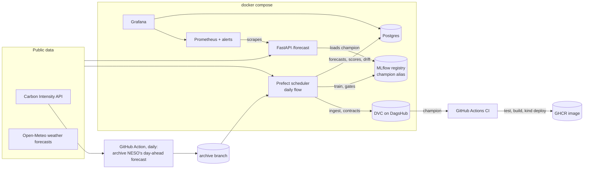

# Carbon Intensity Forecast

[](https://github.com/vladzpop11/carbon-intensity-forecast/actions/workflows/ci.yml)

Day-ahead forecasts of the carbon intensity of Great Britain's electricity (gCO₂/kWh, every half hour), built as an end-to-end MLOps pipeline: versioned data with contracts, orchestrated training, a model registry with promotion gates and rollback, a served API on Docker and Kubernetes, and daily monitoring that scores every forecast once the actual values arrive and retrains when performance drops. The model is scored live against the forecast the grid operator (NESO) publishes a day ahead.



**Model card:** [MODEL_CARD.md](MODEL_CARD.md), one page on intended use, data, results, monitoring and limits.

## The task

Every day at 09:00 UTC, forecast the 48 half hours of the next day (00:00–23:30 UTC, 15 to 38.5 hours ahead), using only what was known at 09:00. This is the decision a flexible electricity user makes: when to run tomorrow.

## Results

Mean absolute error in gCO₂/kWh (lower is better). Rolling origin: each month is forecast by a model trained only on earlier data. The intervals resample whole days ([reports/uncertainty.json](reports/uncertainty.json)).

| | Development, Oct 2024 – Dec 2025 | **Final test, Jan – Sep 2026 (run once)** |
| --- | --- | --- |
| **LightGBM with weather forecasts** | 20.65 (19.71–21.62) | **21.12 (19.89–22.40)** |
| Same half hour, latest day known at 09:00 | 46.27 | 43.90 |
| Same half hour a week before | 56.85 | 50.87 |

- **52% less error than the best simple rule** on the final test (95% interval 47.5–56.1%), and better in every month.
- **The weather forecasts carry the model:** without them the development error doubles (43.25).
- **The final test is a little worse than development on the same months:** January to September 2025 gave 19.58 (18.53–20.73) against 21.12 in 2026, and skill 54.4% against 51.9%. The intervals overlap, so the design did not clearly overfit, but the gap is real enough to state. Most of it is June 2026 (29.5): the model under-forecast throughout (mean error −27) and its skill fell to 28%.
- **NESO's own day-ahead forecast is the real benchmark,** and only exists from 22 October 2026 (see Data). Its comparison will be added once weeks of it have accumulated.

## Data

- [Carbon Intensity API](https://carbonintensity.org.uk) (NESO), CC BY 4.0: actual carbon intensity every half hour since 2018.
- [Open-Meteo](https://open-meteo.com) Previous Runs API, CC BY 4.0: weather forecasts (wind at 100 m, solar radiation, temperature) for ten points that drive GB carbon intensity (wind farms, the sunny south, large cities), as forecast one and two days ahead. Available from March 2024, which is where modelling starts.
- **Why NESO's forecast is archived here:** the API keeps only the latest revision of each forecast, made shortly before the half hour (its error is about 10, against 40 for "same time yesterday"), so its history is not a day-ahead benchmark, and NESO publishes no older versions. A scheduled GitHub Action ([archive.yml](.github/workflows/archive.yml)) saves, every morning, NESO's forecast for the next day as published, the weather forecasts as served at that moment, and the last 9 days of actual values as published then (they are revised later), to the `archive` branch. A NESO forecast read more than an hour after 09:00 had hours more information; it is kept apart as "neso_late" and not counted as the benchmark (22 October 2026 was read at 12:03).
- **Data contracts** ([schemas.py](src/carbon_intensity_forecast/schemas.py), Pandera): a batch with broken structure is refused; values outside physical limits are set to missing and counted in [reports/data_quality.json](reports/data_quality.json), and more than 1% of them in the batch's last 30 days refuses it. The source has some: zeros during estimation outages (2023, 2026) and forecasts up to 13,579 gCO₂/kWh (2018–19). A live forecast is also refused when any input it needs is missing (every weather point and hour, the last known values), rather than made from gaps.
- **Versioned with DVC** on [DagsHub](https://dagshub.com/vladzpop11/carbon-intensity-forecast); `make data-pull` gets the version a commit points to.

## How it avoids hindsight

A day-ahead forecast is easy to make look better than it is. Each feature is built from what existed at 09:00 ([features.py](src/carbon_intensity_forecast/features.py)):

- **Actual values** only up to an hour before (each half hour is published at its end; 30 minutes' margin).
- **Weather forecasts** at the shortest lead already published. Open-Meteo's "forecast from a day earlier" for a time t is the latest run made at least 24 hours before t; with 6 hours' margin for publication, tomorrow 00:00–03:00 uses day-ahead forecasts and the rest two-day-ahead ones.
- **Checked against what was served:** the first two archived snapshots (21 and 22 October, read at 20:52 and 12:03) match the downloaded history exactly where the rule says a value was final; the runs were published within about 3.5 hours, inside the 6-hour margin. Snapshots taken at 09:00 will keep checking this.
- **A test** ([test_features.py](tests/test_features.py)) shows the features follow these rules: changing every value the rules call unpublished at 09:00 leaves them identical, and changing known values changes them. It proves consistency with the rules, not the rules themselves; the archive does that.

## How decisions were made

Everything below was written into [configs/config.yaml](configs/config.yaml) and committed before the run it governs:

1. **Evaluation periods:** development months for every choice; the final-test months scored once when the design was frozen; then live scoring.
2. **Experiments** ([experiments.py](src/carbon_intensity_forecast/experiments.py), [reports/experiments.json](reports/experiments.json)): three candidate setups and one ablation, each logged to MLflow with its git commit and DVC data version. Rule: lowest development error, keeping the original unless beaten by more than 0.2. Chosen: the L1 objective (20.65 against 21.00). The evidence is modest: the gain's 95% interval is 0.04–0.67, and L1 was better in 8 of 15 months.
3. **The final test** ([reports/final_test.json](reports/final_test.json)) was run once. Its first report scored the baselines as `nan` (a faulty value set to missing left a baseline without input on 2 half hours); the scoring was fixed and the test rerun as a recorded revision, with identical model predictions. Per-row predictions are now saved, so a report can always be rescored without rerunning.

## The pipeline

```
make flow   (Prefect)
  ingest      download both sources, check the contracts       ingest.py, schemas.py
  version     dvc add + push to DagsHub                         flows.py
  train       evaluation twin on all but the last 28 days       train.py
  gates       vs baseline (≥ 30% skill) and vs the champion
  register    refit on all data, MLflow version, alias champion
```

**Promotion gates** ([train.py](src/carbon_intensity_forecast/train.py)): the challenger must beat the baseline by at least 30% and have a strictly lower error than the current champion, all on the same holdout half hours of the last 28 days. The comparison is kept fair: a champion trained before the window is compared as it is; one that has seen part of the window has its settings retrained on the challenger's data; a refresh of the champion's own settings passes only with newer data. `make rollback` moves `champion` back to the version it replaced; `make promote VERSION=n` is a manual, recorded override.

## Serving

- **The API** ([api.py](src/carbon_intensity_forecast/api.py), [serving.py](src/carbon_intensity_forecast/serving.py)): `GET /forecast` returns the forecast issued at 09:00 UTC for the next day's 48 half hours. It fetches the live inputs, passes them through the same data contracts and the same feature code as training, and only uses what was published by 09:00. Each issue day's forecast is computed once and then kept, like a published forecast; concurrent requests share the computation. A model never forecasts an issue day it was trained through. Inputs that fail a contract or sources that do not answer give a 503, logged and counted. `GET /health`, `GET /metrics` (Prometheus).
- **The model** is the registry's champion (`MODEL_URI=models:/carbon-intensity-day-ahead@champion`), loaded by its exact version; a background thread checks every 10 minutes whether the alias has moved. If the registry has no champion at start, the API serves the champion exported into the image (`make export-model`, versioned with DVC), as it always does on Kubernetes and in CI.
- **`make up`** starts MLflow (:5050), the API (:8000), Prometheus (:9090), Grafana (:3000), Postgres, the Prefect server (:4200) and the scheduler, with Grafana's data sources and dashboards provisioned from [monitoring/](monitoring/). Measured: about 1.5 GB for all seven, within Docker's 4 GB on this Mac.
- **Kubernetes** ([k8s/](k8s/)): a kustomize base (non-root, read-only root filesystem, probes, limits) and a kind overlay. `make kind-up` creates a local cluster and deploys (cluster 54 s, rollout 23 s, 1.36 GB).
- **CI** ([ci.yml](.github/workflows/ci.yml)): lint, tests and a dependency audit; then the image is built with the champion pulled from DagsHub, smoke-tested with a live forecast, deployed to a throwaway kind cluster, and published from `main` to [GHCR](https://github.com/vladzpop11/carbon-intensity-forecast/pkgs/container/carbon-intensity-forecast) (`docker pull ghcr.io/vladzpop11/carbon-intensity-forecast:latest`).

## Monitoring and retraining

Every day at 09:30 UTC the scheduler (compose) runs the daily flow ([flows.py](src/carbon_intensity_forecast/flows.py), [monitor.py](src/carbon_intensity_forecast/monitor.py)):

1. **Ingest and version** the data (contracts, DVC push).
2. **Issue:** store the champion's forecast and the baseline for every issue day without one, through the same code path as the API. A forecast uses only what was published by 09:00 on its issue day, so a day missed while the machine was off is filled in later, with nearly the same result (actual values are revised by 1–2 gCO₂/kWh after publication). A model never forecasts an issue day it was trained on.
3. **Benchmark:** store NESO's day-ahead forecast as archived that morning ("neso" if read within an hour of 09:00, else "neso_late").
4. **Score:** once a target day's 48 actual values are in (faults removed), the MAE of each method present that day, on the half hours they all cover.
5. **Drift report** ([Evidently](https://www.evidentlyai.com), reports/drift/): the inputs of the last 28 issue days against the same season in earlier years.
6. **Decide** (rules fixed in [config.yaml](configs/config.yaml) before the first live score): retrain when the model's MAE over its last 14 scored days exceeds 1.3 × the development MAE (26.8, with at least 7 scored days) or the champion was trained through more than 28 days ago; not within 7 days of the last completed training (a failed one is retried the next day). The new model still has to pass the promotion gates; every run then makes sure the exported champion matches the registry, and the API loads a new champion within 10 minutes.

**Grafana** ([monitoring/](monitoring/)): "Forecast quality" (daily and rolling MAE of the model, NESO and the baseline, forecasts against actual values, drift, every retraining decision, and how long since the daily flow last ran, red after 26 hours) and "Forecast API" (traffic, latency, forecasts computed, contract and upstream failures, model version). **Prometheus alerts:** the API down for 5 minutes, live inputs refused, slow forecasts. They show in Prometheus and Grafana; nothing sends notifications on this laptop setup.

**Why input drift does not trigger retraining** ([drift_history.py](src/carbon_intensity_forecast/drift_history.py), [reports/drift_history.json](reports/drift_history.json)). Over 18 past months, the share of inputs flagged as drifted (28-day windows):

| Test | Reference | Months flagged (share ≥ 0.5) | Mean share |
| --- | --- | --- | --- |
| Evidently default (K-S / Wasserstein) | same days last year | 18 of 18 | 0.79 |
| Evidently default | same season, earlier years | 18 of 18 | 0.87 |
| PSI, 0.25 | same days last year | 13 of 18 | 0.54 |
| PSI, 0.25 | same season, earlier years | 9 of 18 | 0.48 |

With over a thousand autocorrelated half hours, the default significance tests flag everything. PSI measures the size of a shift, but even then a windy month differs from last year's, and weather is exactly what the model takes as input. Over the 9 final-test months the drift share showed no relation to the model's error (correlation −0.16; with 9 points that rules out only a strong relation). Ground truth arrives within a day here, so performance is measured directly, and drift stays a diagnostic. In October 2026 it shows the carbon intensity inputs lower than in earlier years (the grid decarbonises) and temperatures warmer.

## Runbook

- **Performance trigger fired:** in Grafana, check whether NESO's error rose on the same days (an unusual grid, not the model) or only the model's. Check [reports/data_quality.json](reports/data_quality.json) and the drift report for the inputs that moved. The retraining it started is gated: if the challenger does not pass, the champion stays, and the decision is in the "Retraining decisions" panel.
- **A new champion looks wrong:** `make rollback` moves `champion` back to the version it replaced; the API follows within 10 minutes. `make promote VERSION=n` sets any version by hand. Both are recorded on the versions.
- **Live inputs refused** (alert, /forecast answers 503): a source broke its contract (impossible values, broken structure, missing inputs). `docker compose logs api` names the check that failed. Nothing is served from bad inputs; it recovers by itself when the source does (failures are retried after a minute).
- **The API is down:** `docker compose ps`, `docker compose logs api`. If the registry is unreachable at start it serves the champion inside the image and logs it.
- **A rollback, on Kubernetes or the published image:** they serve the exported champion. The next daily run re-exports it when it differs from the registry; commit `models/champion.dvc` and push for CI to publish it.
- **Slow forecasts:** the first request of each day fetches both sources; the rest come from the cache. Check the sources' response times.
- **The scheduler missed days** (machine off): nothing to do. On start it runs the daily flow, which fills in every missed issue day. If that run fails, the error is in `docker compose logs scheduler` and the schedule continues.
- **The daily flow stopped** (Grafana's "hours since the last monitoring run" is red): `docker compose logs scheduler`; the Prefect UI (:4200) shows each run and the failing task.
- **The archive Action did not run:** it has five slots between 09:05 and 11:45 UTC; if all fail, run it from the Actions tab. A day archived later records the time it was read.

## Decisions

- **A direct model, not mlforecast:** one issue time a day and targets 15–39 hours ahead are simplest as one row per (issue day, target) with the lead as a feature, and easy to check for hindsight.
- **NESO's forecast archived by GitHub Actions:** it cannot be recovered later, and a scheduled Action runs even when the laptop is off.
- **Prefect, not Airflow:** a laptop with 4 GB for Docker; the Prefect server and scheduler take about 750 MB.
- **MLflow on SQLite:** one user; the registry, aliases and artifacts are served over HTTP, so clients need no database or storage credentials.
- **The champion inside the image for Kubernetes and CI:** they cannot reach the local MLflow server; the exported folder is versioned with DVC.
- **Performance, not drift, triggers retraining:** above.

## How to run

Python 3.12 via [uv](https://docs.astral.sh/uv/), Docker, and a `.env` with `DAGSHUB_USER` and `DAGSHUB_TOKEN` (never committed).

```bash
make setup         # dependencies
make data-pull     # the data and the exported champion this commit points to
make up            # adds local passwords to .env (make secrets), then MLflow :5050, API :8000,
                   # Prometheus :9090, Grafana :3000, Prefect :4200, Postgres; the scheduler
                   # runs the daily flow now and at 09:30 UTC
make flow          # on a fresh registry: train and register the first champion
make test          # Ruff and pytest
make backtest      # development backtest (reports/backtest.json)
make registry      # champion and challenger versions
make monitor       # issue, benchmark, score, drift, decide (the daily flow runs it)
make daily         # the whole daily flow once
make export-model  # export the champion for the image (then `make data-push`)
make kind-up       # deploy to a local kind cluster (stop compose first); make kind-down
```

## Mac notes

Built on a 2018 MacBook Air (2 cores, 8 GB, Docker limited to 4 GB):

- **MLflow server:** `MLFLOW_SERVER_ENABLE_JOB_EXECUTION=false` and `--workers 1` (1.1 GB otherwise; 364 MB with both), host port 5050 (AirPlay holds 5000).
- **Models are logged in LightGBM's native format** (the booster), not as a pickle: loading a model never runs stored code.
- **Prefect 3.9:** 3.8.8 accepts FastAPI 0.159, which breaks its local server.
- **GitHub's scheduler can skip runs** (both slots on 22 October 2026), so the archive job has five idempotent slots.

## Security

- **Secrets:** the DagsHub token lives in `.env` locally (git ignores every `.env` variant; mode 600) and in the repository secret `DAGSHUB_TOKEN` for CI. The local passwords (Postgres, Grafana's database role, Grafana's admin) are random values `make secrets` writes to `.env`; no password is committed.
- **Least privilege:** Grafana reads Postgres through a SELECT-only role; the scheduler runs as a non-root user that can write only `data/`, `models/`, `reports/` and DVC's state (code, configuration and git are mounted read-only); in CI only the publishing job can write packages, and only on `main`.
- **Models** are stored in LightGBM's native text format, not as pickles: loading one never runs stored code.
- **The API image** has no development tools (and no pip), runs as a non-root user, and on Kubernetes with a read-only root filesystem, no Linux capabilities, no service-account token and the "restricted" Pod Security Standard. Only GET and HEAD are served.
- **Local services** are bound to 127.0.0.1. Grafana lets anonymous visitors view dashboards (read-only queries), and neither Grafana nor Prefect checks the Host header, so a malicious web page could still read them through DNS rebinding; acceptable on a single-user laptop, not for a shared machine.
- **CI audits** every installed dependency with `pip-audit`. One advisory is accepted: PYSEC-2026-2447 in `diskcache` (no fixed release), used by DVC's local cache. Exploiting it needs write access to that cache as the same user, and DVC is not in the served image.

## Limitations

- **The headline comparison is not in yet.** No live day has been scored against NESO's day-ahead forecast as of 22 October 2026; the first is 23 October. Until weeks have accumulated, the evidence is the backtest against simple baselines, not against the operator.
- **Hindsight is limited, not proven absent.** Actual values are revised after publication (by 1–2 gCO₂/kWh), and the history holds the latest revision. The weather history comes from the Previous Runs API; its availability rule was checked on two days, not at 09:00, and Open-Meteo's mix of weather models may have changed over 2024–26. The archive's daily snapshots are there to measure both.
- **One final test, nine months.** Its interval is about ±1.3 gCO₂/kWh; the development choices rest on modest margins (the L1 gain's interval starts at 0.04).
- **Regime shifts.** June 2026 shows the model can be biased for weeks (mean error −27, skill 28%, below the 30% promotion gate, so no challenger would have been promoted). The model has no inputs for power-station outages, interconnector flows or demand; ten weather points stand in for the whole of Great Britain; training data starts in March 2024.
- **Point forecasts only,** for the national average, on UTC days; no uncertainty band per half hour.
- **The retraining rules and the refresh gate are untested in live use;** they have unit tests, not history.
- **The served champion (version 3) was trained from uncommitted code** (its git_dirty tag is True; the code differed only by work in progress at that commit). The next training records a clean commit.
- **Runs on one laptop.** The daily flow needs Docker running; missed days are filled in later. GitHub disables scheduled workflows in repositories without activity for 60 days, which would stop the archive.

## Licence

Code: [MIT](LICENSE). Data: NESO Carbon Intensity API and Open-Meteo, both CC BY 4.0.
